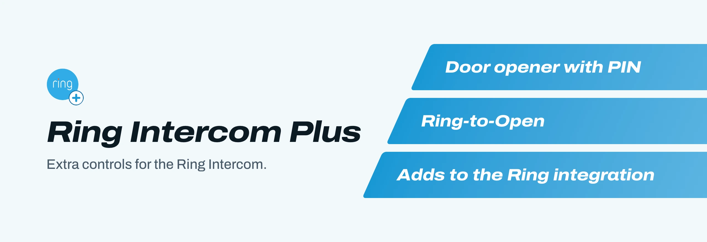

<div align="center">

<picture>
  <source media="(prefers-color-scheme: dark)" srcset="docs/images/readme-title-dark.webp" />
  
</picture>

[](https://github.com/SH1FT-W/ring-intercom-plus/releases/latest)
[](https://www.home-assistant.io)
[](https://hacs.xyz)

<a href="https://sh1ft-w.github.io/ring-intercom-plus"><b>Website</b></a>&emsp;<a href="#get-started">Get started</a>&emsp;<a href="#entities">Entities</a>&emsp;<a href="#next-ring-opens">Next ring opens</a>&emsp;<a href="CHANGELOG.md">Changelog</a>

</div>

<br/>

The switches of the Ring app for your **Ring Intercom** in Home Assistant: **open the door, with an optional PIN, see the ding and an active call, set Ring-to-Open and the unlock duration, restart it.** It runs next to the official [Ring integration](https://www.home-assistant.io/integrations/ring/) and uses its login, so there is nothing to enter.

Everything goes through the Ring cloud, using the requests the Ring app sends. Ring does not document or support them and can change them at any time; single entities may then stop working until the integration is adapted.

> [!WARNING]
> **The door opener opens a real door.** Without a PIN it does so on every `lock.unlock` call: voice assistants, dashboards, automations, scripts and anyone with access to your Home Assistant. Set a PIN in the options and do not expose the lock to voice assistants if you do not want that.

## What you get

|  | Ring integration | With Ring Intercom Plus |
|:--|:--:|:--:|
| Login to the Ring account | ✓ | uses Ring's |
| Ring and unlock events | ✓ | ✓ |
| Open the door | button | lock with optional PIN |
| Ding sensor, call active, last opened | | ✓ |
| Next ring opens (experimental) | | ✓ |
| Ring-to-Open, unlock duration, restart | | ✓ |

**New in 26.11:** Next ring opens with a time window of up to 8 hours or a schedule, and a Last opened sensor (in beta 26.11.2b1). Every change is in the [changelog](CHANGELOG.md).

<a id="get-started"></a><a id="install"></a><a id="set-up"></a>
## Get started

The **official Ring integration** must be set up and show the intercom as a device, with its event entities for ding and intercom unlock enabled.

1. **Install it.** Ring Intercom Plus is a custom repository. Under **Settings > Marketplace** (called HACS before Home Assistant 2026.11), open the three dots menu, choose **Custom repositories** and add `https://github.com/SH1FT-W/ring-intercom-plus` with the type **Integration**. Then search for **Ring Intercom Plus**, download it and restart Home Assistant.
2. **Add the integration.** **Settings > Devices & services > Add integration > Ring Intercom Plus.** It finds the Ring integration and its intercoms by itself; without Ring the setup stops with a message.
3. **Set a PIN** (recommended). **Configure > PIN for the door opener**, 4 to 8 digits. From then on the lock opens only with the right code, in dashboards, automations and voice assistants alike. Leave the field empty to remove it.
4. **Pick a schedule** (optional). **Configure > Schedule for "Next ring opens"**, see [below](#next-ring-opens).

The entities sit on the intercom's device of the Ring integration. Coming from ring-mqtt, you can rename them to your old entity IDs; automations and dashboards then keep working.

<details>
<summary>Install by hand</summary>

1. Download the [latest release](https://github.com/SH1FT-W/ring-intercom-plus/releases/latest).
2. Copy `custom_components/ring_plus` into `/config/custom_components/` and restart Home Assistant.

</details>

<a id="entities"></a>
## Entities

IDs for an intercom named "Front Door". Names are in English and German.

| Entity | Shows |
|:--|:--|
| `lock.front_door_door_opener` | Opens the door, shows unlocked for 5 seconds, also when opened from the Ring app |
| `binary_sensor.front_door_ding` | On for 20 seconds after each ring |
| `binary_sensor.front_door_call_active` | Followed after a ring until the conversation ends, at most 3 minutes |
| `sensor.front_door_last_opened` | When the door was last opened, attributes `source` and `user`. Kept across restarts |
| `switch.front_door_next_ring_opens` | Experimental, see [below](#next-ring-opens). Attributes `until` and `mode` |
| `number.front_door_next_ring_opens_time_window` | 1 to 480 minutes, default 1 |
| `switch.front_door_ring_to_open` | On = Ring-to-Open, off = open directly, as in the Ring app |
| `number.front_door_unlock_duration` | 1 to 10 seconds, only on analog systems |
| `button.front_door_restart` | Restarts the intercom |

Diagnostic sensors: hardware revision, intercom type and unlock mode.

<details>
<summary>Sources of "Last opened"</summary>

| `source` | Meaning |
|:--|:--|
| `home_assistant` | The door opener of Ring Intercom Plus. `user` names the Home Assistant user, if the action came from one |
| `auto_unlock` | Next ring opens with a time window or a schedule |
| `ring_app` | An unlock from the Ring app or another Ring client (for example the "Open door" button of the Ring integration) |
| `ring_history` | An unlock in the Ring history, seen through the Ring integration's "Last activity" |
| `unknown` | An unlock while the intercom's own 60 second mode was armed, so it could be either |

Openings that Ring does not report (for example the button on the indoor handset) do not show up.

</details>

<a id="next-ring-opens"></a>
## Next ring opens

Switch it on and the next ring opens the door; then the switch turns itself off. How long it waits is set with the time window number or the action `ring_plus.next_ring_opens`.

| Time window | Who opens | Note |
|:--|:--|:--|
| 1 minute (default) | The intercom itself, within 60 seconds | From the guest access of the Ring app, tested with an owner account, not an official feature. Ring then sends no ding |
| 2 minutes to 8 hours | Home Assistant, same command as the door opener | Only for a new ring that arrives by push (at most 30 seconds old). If opening fails, the window stays on |
| Schedule helper is on | Home Assistant, on **every** ring by push | Switching the switch off pauses the schedule until it turns off |

The window and a pause survive restarts. If Ring does not return the user ID of the account, only the 1 minute mode is missing.

> [!WARNING]
> With a time window or a schedule, **anyone who rings opens the door**, and the PIN does not apply. Use it only when you expect someone.

## Examples

Open the door with the PIN:

```yaml
action: lock.unlock
target:
  entity_id: lock.front_door_door_opener
data:
  code: "1234"
```

<details>
<summary>Next ring opens for two hours</summary>

```yaml
action: ring_plus.next_ring_opens
target:
  entity_id: switch.front_door_next_ring_opens
data:
  duration:
    hours: 2
```

`duration` is optional (1 minute to 8 hours); without it, the time window number is used.

</details>

## Your data

- **No login of its own.** Ring Intercom Plus borrows the logged-in client of the Ring integration and stores no credentials.
- **No second push connection.** Rings and unlocks come from the event entities of the Ring integration; commands go to the Ring cloud.

## Good to know

- Tested on a Ring Intercom (Audio). The video model uses the same commands but is untested.
- If the Ring integration stops getting push messages (a known problem), a ring is still detected from its "Last activity" about a minute later, and a repair suggests reloading Ring after two such rings in a row. Such a ring never opens the door.
- A new intercom in the Ring integration appears only after reloading Ring Intercom Plus.

<details>
<summary>Troubleshooting</summary>

- **"Retrying setup"** after start: the Ring integration is not loaded yet, or its internal structure changed (message in the log). Ring Intercom Plus loads by itself once Ring is loaded.
- **Ding does not react.** The event entities of the Ring integration (ding and intercom unlock) must be enabled. Renaming them is fine.
- **Next ring opens fails with "user ID".** Ring did not return the user ID (see the log). Time windows of 2 minutes or more and the schedule keep working.
- **"Unlock duration" is missing.** It exists only on analog systems, as in the Ring app.
- **Entities unavailable.** The Ring integration is unloaded or Ring does not answer; once it is loaded again, Ring Intercom Plus reloads.
- **"Ring did not accept the command".** Ring rejected it or changed the API. Please open an issue with the log lines.
- **Debug log:**

  ```yaml
  logger:
    logs:
      custom_components.ring_plus: debug
  ```

When you open an [issue](https://github.com/SH1FT-W/ring-intercom-plus/issues), remove your email address, tokens and device IDs from the log lines.

</details>

<details>
<summary>Remove</summary>

1. **Settings > Devices & services > Ring Intercom Plus > three dots > Delete**.
2. Remove the repository in the Marketplace (or delete `/config/custom_components/ring_plus`) and restart Home Assistant.

The Ring integration and its device stay untouched.

</details>

<details>
<summary>How it works</summary>

| What | How |
|:--|:--|
| Login and connection | The authenticated client of the Ring integration ([python-ring-doorbell](https://github.com/python-ring-doorbell/python-ring-doorbell)) |
| Rings and unlocks | Event entities of the Ring integration, "Last activity" as fallback |
| Settings | Read every 5 minutes and right after each change |
| Commands | Through the Ring cloud. Unlock as in python-ring-doorbell, the rest as in the Ring app |

Ring Intercom Plus never sends the intercom's calibration or setup commands. Details are in [`NOTICE`](NOTICE) and, in German, in [`CLAUDE.md`](CLAUDE.md).

</details>

<details>
<summary>Development</summary>

```bash
.venv/bin/python -m pytest -q -p no:logging --cov=custom_components/ring_plus   # fake Ring cloud in tests/common.py
uvx ruff check . && uvx ruff format --check .
uvx mypy@2.3.1 --python-executable .venv/bin/python
.venv/bin/python tools/pruefe-uebersetzungen.py    # strings.json against translations/*.json
```

Test requirements: `pip install -r requirements_test.txt`. The tests never talk to Ring; they also run against the real Ring integration of Home Assistant. GitHub Actions runs the same checks plus HACS validation and hassfest. Quality scale: silver, [self-assessed](custom_components/ring_plus/quality_scale.yaml).

</details>

## License

[Apache License 2.0](LICENSE). Copyright 2026 SH1FT-W. Acknowledgements in [`NOTICE`](NOTICE).

<sub>Ring Intercom Plus is an independent project, not affiliated with, endorsed or sponsored by Ring LLC or Amazon. Ring is a trademark of Ring LLC or its affiliates.</sub>

<br/>

<div align="center">
<a href="https://sh1ft-w.github.io"></a>
<br/>
<sub>More open source for Home Assistant and the Mac at <a href="https://sh1ft-w.github.io">sh1ft-w.github.io</a></sub>
<br/>
<sub>Like this project? <a href="https://buymeacoffee.com/sh1ft_w">Buy me a coffee</a></sub>
</div>
