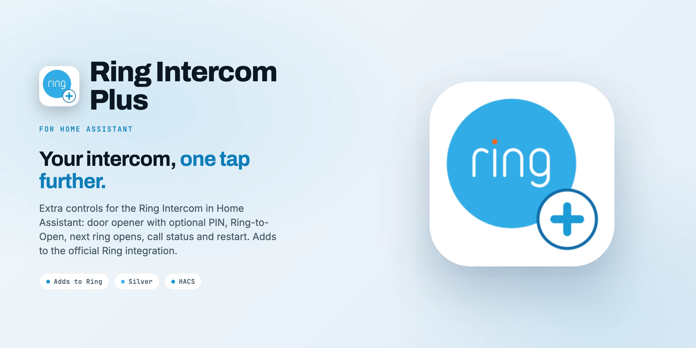
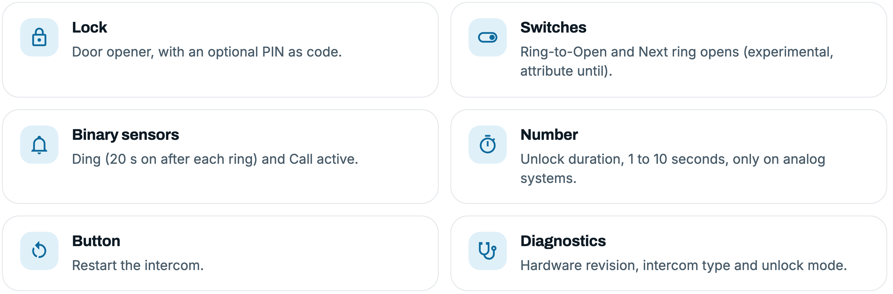
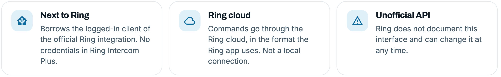

<div align="center">



<p>Door opener, ding, call active, Ring-to-Open, unlock duration and restart for the <b>Ring Intercom</b>.<br/>
Runs next to the official Ring integration and uses its login.</p>

[](https://github.com/SH1FT-W/ring-intercom-plus/releases/latest)
[](https://www.home-assistant.io)
[](https://hacs.xyz)
[](https://developers.home-assistant.io/docs/creating_integration_manifest/#iot-class)
[-1998D5?style=flat-square&labelColor=111111)](custom_components/ring_plus/quality_scale.yaml)
[](LICENSE)

<p><a href="https://sh1ft-w.github.io/ring-intercom-plus"><b>Website</b></a> &nbsp;·&nbsp; <a href="#features">Features</a> &nbsp;·&nbsp; <a href="#entities">Entities</a> &nbsp;·&nbsp; <a href="#installation">Install</a> &nbsp;·&nbsp; <a href="#options-pin-for-the-door-opener">PIN</a> &nbsp;·&nbsp; <a href="#troubleshooting">Troubleshooting</a> &nbsp;·&nbsp; <a href="CHANGELOG.md">Changelog</a></p>

</div>

<br/>

Ring Intercom Plus adds the intercom functions that the official [Ring integration](https://www.home-assistant.io/integrations/ring/) does not offer: opening the door as a lock entity with an optional PIN, a ding sensor, "call active", Ring-to-Open, the unlock duration and a restart button. It has **no login of its own**: it uses the Ring integration's connection to the Ring cloud, so there is nothing to enter during setup.

> [!WARNING]
> **The door opener opens a real door.** Without a PIN it does so on every `lock.unlock` call, from anything that can reach the lock: **voice assistants, dashboards, automations, scripts** and anyone with access to your Home Assistant. If you do not want that, set a PIN in the options (see below) and do not expose the lock to voice assistants.

> [!CAUTION]
> Ring Intercom Plus uses the **unofficial Ring API** (the requests the Ring app sends). Ring does not document or support it and can change it at any time; single entities may then stop working until the integration is adapted. All commands go through the **Ring cloud**; nothing here is local.

> [!NOTE]
> Ring Intercom Plus is an independent project. It is not affiliated with, endorsed by or sponsored by Ring LLC or Amazon. Ring is a trademark of Ring LLC or its affiliates.

<a id="features"></a>
## Features

<picture>
  <source media="(prefers-color-scheme: dark)" srcset="docs/images/readme-cards-features-dark.png" />
  
</picture>

- **Door opener** as a lock: opens the door and shows "unlocked" for 5 seconds, also when the door is opened from the Ring app.
- **Optional PIN** for the door opener (4 to 8 digits), checked for every `lock.unlock`.
- **Ding** sensor (on for 20 seconds after each ring) and **Call active** (polled after a ring until the conversation ends, at most 3 minutes).
- **Ring-to-Open**, **unlock duration** (1 to 10 seconds, analog systems only) and **restart**, like in the Ring app.
- Rings and unlocks are read from the event entities of the Ring integration: **no second push connection** to Ring. Settings are read every 5 minutes and right after each change.
- All entities are attached to the device of the Ring integration, so the intercom stays one device.
- English and German.

**Tested on:** Ring Intercom (Audio). The video model uses the same commands but is not tested.

<a id="entities"></a>
## Entities

<picture>
  <source media="(prefers-color-scheme: dark)" srcset="docs/images/readme-cards-entities-dark.png" />
  
</picture>

| Entity | Type | What it does |
|---|---|---|
| Door opener | lock | Opens the door, shows "unlocked" for 5 s (also when opened from the Ring app) |
| Next ring opens | switch | **Experimental**, see below. Attribute `until` |
| Ring-to-Open | switch | On = Ring-to-Open, off = open directly, as in the Ring app |
| Ding | binary sensor | On for 20 s after each ring |
| Call active | binary sensor | Polled after a ring until the conversation ends (at most 3 minutes) |
| Unlock duration | number | 1 to 10 s, only on analog systems |
| Restart | button | Restarts the intercom |
| Hardware revision, Intercom type, Unlock mode | diagnostic sensors | Read from the intercom |

Entity IDs start with the device name of the Ring integration, for example `lock.front_door_door_opener`. Coming from ring-mqtt, you can rename the new entities to your old entity IDs; automations and dashboards then keep working.

### "Next ring opens" (experimental)

Switching it on asks the intercom to open the door on the next ring within 60 seconds; the switch turns itself off afterwards. The command comes from the **guest access** feature of the Ring app. It was tested with an **owner account** and opened the door, but it is not an official Ring feature, so treat it as experimental. The switch is missing if Ring does not return the user ID of the account.

When Ring opens the door this way, it sends **no ding event** to Home Assistant, so the ding sensor stays off and the switch turns off at the end of its 60 seconds instead of right away.

### Rings without push

The official Ring integration learns about rings through instant push messages. If those stop arriving (a known problem; reloading or reconfiguring the Ring integration usually fixes it), Ring Intercom Plus still detects a ring from the integration's regular "Last activity" check, about a minute later, and shows a repair issue after two such rings in a row.

<a id="installation"></a>
## Installation

**Requirements:** Home Assistant 2026.9 or newer and the **official Ring integration**, set up and showing the intercom as a device.

### HACS (custom repository)

1. In HACS, open the three dots menu, choose **Custom repositories** and add `https://github.com/SH1FT-W/ring-intercom-plus` with the type **Integration**.
2. Search for **Ring Intercom Plus**, download it and restart Home Assistant.

### Manual

1. Download the [latest release](https://github.com/SH1FT-W/ring-intercom-plus/releases/latest).
2. Copy the folder `custom_components/ring_plus` into `/config/custom_components/` and restart Home Assistant.

## Setup

**Settings > Devices & services > Add integration > Ring Intercom Plus.** There is nothing to enter: Ring Intercom Plus finds the Ring integration and its intercoms. If the Ring integration is not set up, the setup stops with a message.

## Options: PIN for the door opener

**Settings > Devices & services > Ring Intercom Plus > Configure:** enter a PIN with 4 to 8 digits. From then on the lock asks for a code (`lock.unlock` with `code`) in dashboards, automations and voice assistants alike; a wrong or missing code opens nothing. Leave the field empty and save to remove the PIN. Default: no PIN.

```yaml
action: lock.unlock
target:
  entity_id: lock.front_door_door_opener
data:
  code: "1234"
```

## Troubleshooting

- **"Retrying setup"** after start: the Ring integration is not loaded yet, or its internal structure changed (message in the log). Ring Intercom Plus loads by itself as soon as Ring is loaded.
- **Ding does not react:** the event entities of the Ring integration (ding and intercom unlock) must be enabled. Renaming them is fine, Ring Intercom Plus follows the new ID.
- **"Next ring opens" is missing:** Ring did not return the user ID of the account (see the log); everything else keeps working.
- **"Unlock duration" is missing:** it exists only on analog systems, as in the Ring app.
- **Entities "unavailable":** the Ring integration is unloaded or Ring does not answer; once it is loaded again, Ring Intercom Plus reloads.
- **A command fails with "Ring did not accept the command":** Ring rejected it or changed the API. Please open an issue with the log lines.
- **Debug log:**

  ```yaml
  logger:
    logs:
      custom_components.ring_plus: debug
  ```

When you open an [issue](https://github.com/SH1FT-W/ring-intercom-plus/issues), please remove your email address, tokens and device IDs from log lines.

### Known limits

- A new intercom in the Ring integration appears in Ring Intercom Plus only after reloading Ring Intercom Plus.
- "Next ring opens" is experimental (see above).

## Removal

1. **Settings > Devices & services > Ring Intercom Plus > three dots > Delete.**
2. Delete the folder `/config/custom_components/ring_plus` (or remove the repository in HACS) and restart Home Assistant.

The Ring integration and its device stay untouched.

## How it works

<picture>
  <source media="(prefers-color-scheme: dark)" srcset="docs/images/readme-cards-how-dark.png" />
  
</picture>

Ring Intercom Plus calls the authenticated client of the Ring integration (from [python-ring-doorbell](https://github.com/python-ring-doorbell/python-ring-doorbell)) for every request. The unlock command follows python-ring-doorbell; the other commands and settings follow the Ring app. Ring Intercom Plus never sends the intercom's calibration or setup commands. Details are in [`NOTICE`](NOTICE) and, in German, in [`CLAUDE.md`](CLAUDE.md).

## Development

```bash
.venv/bin/python -m pytest -q -p no:logging --cov=custom_components/ring_plus   # fake Ring cloud in tests/common.py
uvx ruff check . && uvx ruff format --check .
uvx mypy@2.3.1 --python-executable .venv/bin/python
.venv/bin/python tools/pruefe-uebersetzungen.py    # strings.json against translations/*.json
```

Install the test requirements with `pip install -r requirements_test.txt`. The tests never talk to Ring. The same checks run on GitHub Actions for every push and pull request, plus HACS validation and hassfest. Self-assessed state of the [Integration Quality Scale](https://developers.home-assistant.io/docs/core/integration-quality-scale/): [`quality_scale.yaml`](custom_components/ring_plus/quality_scale.yaml).

## License

[Apache License 2.0](LICENSE), Copyright 2026 SH1FT-W. See [`NOTICE`](NOTICE) for acknowledgements and trademarks.
